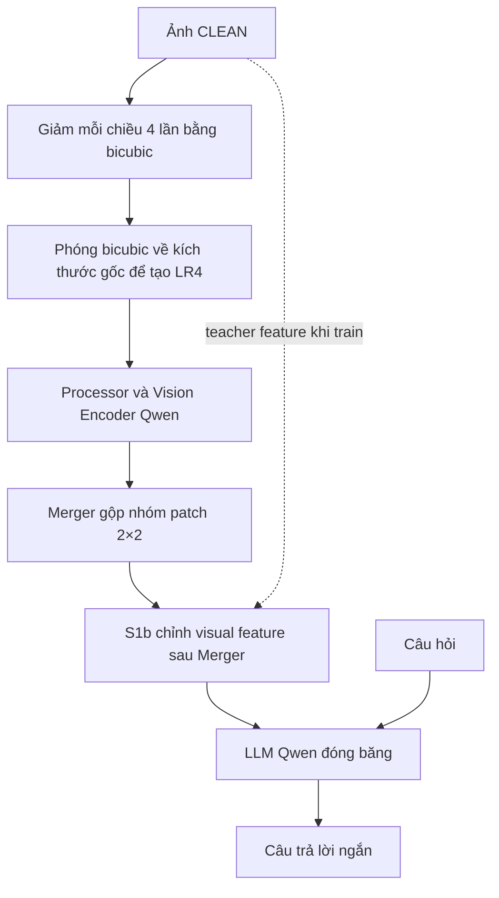

# Q-LRG — Phục hồi visual feature cho TextVQA trên ảnh LR4

Bản tổng hợp phục vụ đồ án môn học, cập nhật ngày 19/11/2026.
Phần việc chính là phục hồi latent toàn ảnh bằng Qwen2.5-VL-3B-Instruct.
Bảng kết quả chính lấy từ job 52963, cùng 5.000 câu trên 3.166 ảnh validation
chính thức. Phân tích định tính đi kèm 36 ca đã xem ảnh CLEAN và LR4.

## 1. Bài toán và câu hỏi nghiên cứu

Scene Text VQA yêu cầu đọc chữ trong ảnh rồi trả lời câu hỏi dựa trên ảnh.
Giảm độ phân giải làm mất nét ký tự và tăng nhầm lẫn giữa các dòng chữ,
trong khi câu hỏi vẫn có thể cần nhận diện đối tượng hoặc ngữ cảnh toàn cảnh.

Đầu vào là ảnh bị suy giảm và câu hỏi. Đầu ra là câu trả lời ngắn.
Mục tiêu là cải thiện TextVQA accuracy bằng module phục hồi visual feature,
đồng thời đo tác động lên ảnh CLEAN và chi phí suy luận.

Ba câu hỏi dùng để tổ chức thực nghiệm cuối gồm

1. S1b, module phục hồi sau Merger, có cải thiện so với Qwen gốc trên LR4?
2. Chuyển module lên trước Merger có tốt hơn ở cùng ngân sách huấn luyện?
3. Lợi ích của phục hồi so với A2, đối chứng thích nghi LLM bằng LoRA, thế nào?

## 2. Workflow và phương pháp



S1b tính `F_restored = F_LR4 + delta`. Module có lớp giảm chiều với LayerNorm,
hai khối xử lý không gian gồm depthwise convolution 3×3 và pointwise
convolution, rồi lớp chiếu về chiều feature ban đầu. Lớp đầu ra của residual
khởi tạo bằng 0. Module khai thác thông tin từ các token lân cận.

Trong nhánh Pre, thứ tự là

```text
Ảnh LR4 → Vision Encoder → Pre trên lưới patch → Merger → LLM + câu hỏi → Đáp án
```

Qwen sắp patch theo cửa sổ attention. Nhánh Pre đưa chúng về đúng lưới ảnh
để chạy module không gian, sau đó trả về thứ tự của Qwen trước Merger.
Các kiểm tra residual bằng 0 xác nhận feature và logits prefill khớp A0.
Gradient được kiểm tra có truyền qua Merger đóng băng tới module Pre.

Vision Encoder, Merger và LLM được đóng băng ở S1b và Pre. Backpropagation
qua LLM vẫn cần thiết để loss đáp án cập nhật module phục hồi. Khi suy luận,
module nhận feature từ ảnh và câu hỏi đi vào LLM. CLEAN teacher và đáp án
tham chiếu cung cấp giám sát trong quá trình huấn luyện.

| Ký hiệu | Cơ chế | Tham số trainable | Vai trò |
| --- | --- | ---: | --- |
| A0 | Qwen gốc | 0 | Đối chứng trước khi học thêm |
| S1b | Residual không gian sau Merger | 1.029.152 | Phương án phục hồi chính |
| Pre | Residual không gian trước Merger | 1.027.482 | Ablation vị trí phục hồi |
| A2 | LoRA vào Q/V attention của LLM, rank 4, alpha 8 | 921.600 | Đối chứng thích nghi tác vụ |

Pre có bottleneck 318, S1b có bottleneck 224 để khớp ngân sách tham số,
chênh khoảng 0,16%. Số patch ở đầu vào module Pre lớn gấp bốn lưới sau
Merger. Hai vị trí tạo cùng số visual token cuối cùng đưa vào LLM.

Loss của S1b và Pre được đo trên đầu ra sau Merger

`L = L_answer + 1.0 × MSE(F_restored, F_CLEAN) + lambda × mean(delta²)`

Trong đó `lambda = 0.01` cho LR4 và `0.11` cho CLEAN. Với Pre, delta trong
hạng phạt là thay đổi tổng thể ở đầu ra sau Merger. A2 chỉ học loss đáp án.

## 3. Dữ liệu và cách tách tập

| Tập | Ảnh | Câu hỏi | Công dụng |
| --- | ---: | ---: | --- |
| train_inner | 19.758 | 31.129 | Huấn luyện |
| val_inner | 2.195 | 3.473 | Phát triển và so checkpoint |
| official_val | 3.166 | 5.000 | Bảng so sánh checkpoint đã khóa |

Manifest được tách theo ảnh, kiểm tra image ID, question ID và SHA-256 giữa
các tập. Mọi câu hỏi của một ảnh thuộc cùng split. Dữ liệu đường chính
không cần TextOCR khi suy luận. TextOCR được dùng trong các oracle và một
số ablation giám sát theo vùng chữ.

LR4 dùng Pillow 11.3.0, bicubic giảm về `(max(1,W//4), max(1,H//4))`, sau đó
phóng về `(W,H)`. Processor Qwen chạy tiếp với min_pixels 3.136 và max_pixels
786.432. CLEAN và LR4 có cùng lưới/token để đối chiếu feature theo vị trí.
Ảnh 1.200×800 trở thành 300×200 rồi trở về 1.200×800 trước processor.

Official validation đã được dùng trong các thí nghiệm khác của dự án.
Kết quả cuối cần được mô tả là so sánh checkpoint cố định trên validation.
Một tập holdout mới hoặc test chính thức sẽ bổ sung bằng chứng tổng quát hóa.

## 4. Huấn luyện và đối chứng công bằng

| Thiết lập | S1b và Pre |
| --- | --- |
| Dữ liệu | Cùng manifest 19.758 ảnh / 31.129 câu |
| Epoch, seed | 2 epoch, seed 42 |
| Tiếp xúc dữ liệu | 62.258 lượt câu hỏi, 15.565 bước cập nhật |
| Optimizer | AdamW, learning rate 2e-4, weight decay 0,01 |
| Tích lũy gradient | 4 mẫu câu hỏi / bước, xử lý từng mẫu |
| Max gradient norm | 1,0 |
| Tỷ lệ ảnh CLEAN mỗi epoch | 40%, còn lại LR4 |
| Teacher | Feature từ ảnh CLEAN tương ứng |
| Loss | Cùng mã S1b, cùng hệ số như mục 2 |
| Backbone | Đóng băng Vision Encoder, Merger và LLM |
| Tính toán | UIT-HPC, NVIDIA H200 MIG 2g.35gb, BF16, SDPA |

S1b và A2 lấy checkpoint job 11305. Pre được train ở job 48633 bằng snapshot
mã S1b đã dùng khi resume 11305. Job 52963 chấm cùng lượt cả bốn checkpoint.
Model revision, code hash, manifest hash và checkpoint SHA-256 nằm trong
`run.json` của job 52963. Cách chọn ở lượt này là dùng checkpoint cuối hai
epoch. Chưa xác định được epoch tối ưu và chưa chạy nhiều seed.

## 5. Độ đo

Metric chính là TextVQA MMF soft accuracy. Với mỗi câu, dataset có mười
đáp án từ mười người. Prediction và reference được chuẩn hóa bằng scorer
đã pin revision `72f898ec35af86567423c7a019dd1dc5175d1a5a`.

Scorer lần lượt bỏ một đáp án ra, đếm số khớp trong chín đáp án còn lại,
tính `min(matches/3,1)`, rồi lấy trung bình mười lượt. Sau chuẩn hóa, một,
hai, ba và từ bốn người đồng ý cho điểm lần lượt 0,3; 0,6; 0,9 và 1,0.
Điểm toàn tập là trung bình điểm từng câu nhân 100.

So sánh dùng paired bootstrap 10.000 lần theo cụm image ID. Mỗi lần lấy
mẫu cả cụm câu hỏi cùng ảnh, giữ trọng số theo câu khi tính chênh lệch.
CI 95% mô tả bất định trên tập ảnh của các checkpoint đã có. Biến thiên
giữa các lần huấn luyện cần được đo bằng nhiều seed.

Metric chi phí gồm số visual token, latency p50/p95 encode + phục hồi theo
ảnh, latency toàn request theo câu hỏi, peak allocated VRAM và registered
FLOPs. Quy trình đo chi tiết nằm ở mục 7.

## 6. Kết quả chính trên cùng 5.000 câu

| Cấu hình | CLEAN | LR4 | LR4 trừ A0, điểm phần trăm và CI 95% |
| --- | ---: | ---: | --- |
| A0, Qwen gốc | 78,992% | 63,692% | Mốc |
| S1b, phục hồi sau Merger | 80,026% | 64,958% | +1,266 [+0,474; +2,064] |
| Pre, phục hồi trước Merger | 80,136% | 64,234% | +0,542 [-0,244; +1,301] |
| A2, LoRA attention LLM | 80,814% | 65,274% | +1,582 [+0,758; +2,414] |

| So sánh trực tiếp | Chênh lệch LR4 | CI 95% |
| --- | ---: | --- |
| Pre trừ S1b | -0,724 | [-1,301; -0,134] |
| S1b trừ A2 | -0,316 | [-0,993; +0,354] |
| Pre trừ A2 | -1,040 | [-1,743; -0,322] |

S1b cải thiện so với Qwen gốc và tốt hơn Pre trên LR4 ở seed hiện tại.
A2 có điểm trung bình cao nhất. Chênh lệch A2/S1b còn có CI qua 0.
S1b được giữ làm phương án phục hồi chính để phân tích và demo.

Để xem lợi ích có tập trung riêng vào suy giảm, tính
`interaction = delta(LR4) - delta(CLEAN)` so với A0.

| Cấu hình | Interaction, điểm phần trăm | CI 95% |
| --- | ---: | --- |
| S1b | +0,232 | [-0,679; +1,154] |
| Pre | -0,602 | [-1,503; +0,290] |
| A2 | -0,240 | [-1,188; +0,679] |

Các CI đều qua 0. Kết quả chưa phân giải được mức tăng đặc thù cho LR4.
Đây là lý do cần trình bày A2 và kết quả CLEAN cùng bảng phục hồi.

## 7. Chi phí suy luận

Đo cùng 40 ảnh LR4, batch size 1, hai ảnh warm-up và luân phiên thứ tự cấu
hình. Mỗi request dùng một ảnh và một câu hỏi. Token trung bình ở tập đo là
933,825 cho cả bốn nhánh. Dataset accuracy vẫn dùng đủ 5.000 câu.

| Cấu hình | Encode + phục hồi p50/p95, ms/ảnh | Toàn request p50/p95, ms/câu | Peak VRAM, GiB | Registered FLOPs, TFLOPs |
| --- | ---: | ---: | ---: | ---: |
| A0 | 157,51 / 165,18 | 276,51 / 370,16 | 7,38 | 10,90951 |
| S1b | 157,20 / 165,84 | 275,68 / 324,50 | 7,38 | 10,91142 |
| Pre | 159,19 / 166,99 | 277,14 / 321,03 | 7,38 | 10,91716 |
| A2 | 157,27 / 164,71 | 291,74 / 364,27 | 7,38 | 10,91133 |

FLOPs đo riêng trên mười ảnh với tám bước decode cố định, chỉ đếm operator
PyTorch hỗ trợ. Peak VRAM đo khi cả ba adapter cùng nằm trên GPU.
Latency dùng đáp án thực tế nên độ dài sinh chữ có thể khác giữa cấu hình.
Chênh lệch p95 chưa đủ để kết luận module làm model nhanh hơn. Phần tăng
registered FLOPs của S1b so với A0 khoảng 1,91 GFLOPs và Pre khoảng 7,65 GFLOPs.

## 8. Phân tích đúng/sai

Trên LR4, có 2.805 câu S1b và Pre cùng đạt 1. S1b đạt 1 còn Pre dưới 1 ở
133 câu. Pre đạt 1 còn S1b dưới 1 ở 89 câu. Cả hai cùng dưới 1 ở 1.973 câu,
trong đó 1.431 câu cả hai đạt 0. Bốn nhóm đầu phân hoạch đủ 5.000 câu.

Xét mọi mức điểm, chuyển S1b sang Pre tạo 143 ca tăng, 191 ca giảm và
4.666 ca bằng điểm. Có 98 ca S1b 1 → Pre 0 và 62 ca theo chiều ngược lại.

Đã xem 36 ca có chủ đích, sáu ca mỗi nhóm, có cả tăng, giảm, lỗi chung và
điểm một phần. Bản ghi đầy đủ nằm trong [EDA 36 ca](eda_reviewed_36.md).
Một số ví dụ minh họa gồm

- Câu 37183, GOLDEN DAWN. S1b LR4 nhầm pawn, Pre trả dawn.
- Câu 36855, nhãn BARBIERI phía dưới APEROL. Pre chọn đúng chữ theo vị trí.
- Câu 37614, biển PIZZA PALACE có thêm dòng DRIVE-IN. Pre lấy thêm chữ có
  thật trên biển nhưng khác phạm vi đáp án tham chiếu và bị điểm 0.
- Câu 36411 hỏi lý do nguy hiểm. S1b/Pre chọn Do not enter, trong khi đáp
  án cần Demolition work in progress ở dòng khác.
- Câu 38243 có một đáp án yes trong bộ nhãn. S1b yes được 0,3 dù chưa trả
  được giờ. Cần xem điểm cùng nội dung câu hỏi.

Những lỗi này gồm sai ký tự, chọn nhầm dòng chữ, phạm vi đáp án và mơ hồ
nhãn. Các nguyên nhân bên trong cơ chế attention hoặc restoration còn cần
thí nghiệm can thiệp. Mẫu 36 ca chưa đại diện cho tần suất lỗi toàn tập.

## 9. Vai trò của các thí nghiệm trước

| Giai đoạn | Bằng chứng đã có | Cách dùng trong đồ án |
| --- | --- | --- |
| D0 | Qwen giảm điểm giữa CLEAN và LR4; identity injection qua kiểm tra | Xác nhận vấn đề và tính đúng của đường can thiệp |
| S0 | Thay feature CLEAN tại vùng chữ giúp cải thiện; grounding còn tạm thời | Động cơ phục hồi feature chữ, ghi rõ oracle |
| S1 pilot 10820 | 2.048 ảnh, một epoch, chênh lệch chưa phân giải được | Pilot phục vụ triển khai |
| S1 đầy đủ 11305 | Restorer và adaptation controls, hai epoch trên train_inner | Nguồn checkpoint chính |
| 18970 | Bảy nhánh sau Merger, 4.000 ảnh, một epoch, một seed | Sàng lọc loss/module, có giới hạn ngân sách |
| 42245 / 42415 | Thử vị trí Merger nhưng Post chưa tái lập S1b 11305 | Lưu lịch sử điều tra, kết luận vị trí lấy từ 48633/52963 |
| 48633 / 52963 | Pre dùng mã loss/optimizer 11305 và chấm cùng S1b/A2/A0 | Bảng so sánh chính hiện tại |
| Crop | Bộ chọn vùng, padding, full + crop, token budget | Nhánh nghiên cứu bổ sung, giữ bảng và cohort riêng |

Ở S0, số 92% hồi phục và khoảng 13% token thuộc các nhóm khác nhau trong
registry cũ. Khi dùng số S0, cần ghi đúng cohort. Trên toàn bộ 792 câu,
O2 dùng trung bình 15,58% token và thu hồi khoảng 92% khoảng cách O1/O0.
Trên 150 câu có grounding, O2 dùng 12,97% token và thu hồi khoảng 79,1%.
O3 là oracle dùng vùng đáp án từ nhãn, cần gọi đúng tên khi trình bày.

## 10. Tái lập và demo

Protocol và lệnh chuẩn nằm trong [final_study.md](final_study.md).
Thư mục kết quả trên HPC là

```text
/datastore/dungmt/textvqa/Tuan/Q-LRG-crop/runs/final-tooling-xszFH1L0/runs/final-official_val-5zxrc8y1/
```

`run.json` khóa checkpoint, model, manifest và code. `COMPLETE.json` chứa
checksum các output. Lệnh kiểm tra dưới đây cũng tính lại accuracy từ
toàn bộ dự đoán và kiểm tra mọi nhánh có cùng cohort.

```bash
python3 scripts/verify_final_artifacts.py /absolute/path/to/evaluation
```

`review_lr4.html` và `review_clean.html` lọc toàn bộ dự đoán. `demo.html` là
bản phát lại có ảnh của các ca chọn. `run_final_demo.py` nhận ảnh và câu hỏi
từ CLI, load checkpoint và suy luận trên H200. Job 63914 được nộp để kiểm
chứng CLI với ba ảnh; trạng thái kiểm chứng được ghi trong runbook demo.

## 11. Kết luận và giới hạn

S1b cải thiện TextVQA LR4 so với Qwen gốc với khoảng 1,03 triệu tham số
trainable và giữ điểm CLEAN tăng. Với kiến trúc residual và ngân sách hiện
tại, sau Merger tốt hơn trước Merger trên LR4. A2 có điểm cao nhất, còn
khoảng cách A2/S1b chưa phân giải được. Phần tăng đặc thù cho LR4 so với
CLEAN cũng chưa phân giải được.

Giới hạn gồm một seed, checkpoint cuối hai epoch, validation chính thức đã
được dùng trước trong dự án, dữ liệu suy giảm đường chính là LR4 và EDA
định tính trên mẫu chọn có chủ đích. Hai epoch chưa xác định checkpoint tối
ưu. Các thí nghiệm mở rộng phù hợp là nhiều seed, validation theo epoch và
đánh giá có kiểm soát với Blur/LR4 + Blur trên cùng cohort.

Tài liệu tham khảo và cách các biến thể mượn ý tưởng từ paper đã được ghi
trong [latent_restoration_study.md](latent_restoration_study.md). Các nhánh
đã chạy là những bản thích nghi của dự án, cần ghi rõ thành phần đã triển
khai khi trích dẫn.

## 12. Mức hoàn thiện theo phiếu môn học

| Tiêu chí | Bằng chứng hiện có | Phần còn cần xác nhận |
| --- | --- | --- |
| Lý do và bài toán | Mục 1, D0, oracle S0 | Tên đề tài và phạm vi cuối cùng của nhóm |
| Minh họa | 36 ca có ảnh CLEAN/LR4, câu hỏi và dự đoán | Chọn ví dụ phù hợp thời lượng báo cáo |
| Phương pháp | Mục 2–4, code và ablation vị trí | Hiểu và diễn giải được loss và đối chứng |
| Dataset và metric | Mục 3–5, manifest và scorer pin revision | Đã có bằng chứng kỹ thuật |
| Kết quả | Mục 6–9, đủ 5.000 câu và CI, chi phí | Nhiều seed là bước tăng độ chắc của kết luận |
| Demo | Trang phát lại và CLI đã có, job 63914 đã nộp | CLI H200 chờ tài nguyên tại thời điểm viết |
| Nhận xét và kết luận | Mục 8 và 11, có cả ca tăng và giảm | Trình bày đúng giới hạn một seed |
| Tài liệu trình bày | Báo cáo Markdown và registry | Chưa tạo sản phẩm trình bày cuối của nhóm |
| Hỏi đáp | Các câu hỏi trong runbook demo | Thành viên cần tự giải thích được quyết định |
